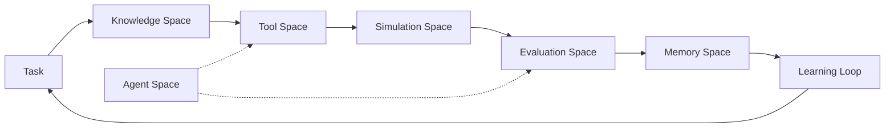

<div align="center">


[](https://github.com/cokovali10-sketch/matrix)

[](https://python.org)
[](https://github.com/cokovali10-sketch/matrix/actions)
[](https://github.com/cokovali10-sketch/matrix)
[](LICENSE)
[](https://github.com/cokovali10-sketch/matrix/stargazers)

</div>

---

## 🧠 What is MATRIX?

MATRIX is not just a knowledge base or a chatbot. It is a **full artificial work environment** where AI agents acquire knowledge, use tools, solve tasks, get feedback, store experience, and measurably improve — all without changing model weights.

> **Build real things. Measure honestly. Document the gaps.**

---

## ✨ Features

| Space | Capability |
|-------|-----------|
| 📚 **Knowledge** | TF-IDF semantic search, versioning, import/export |
| 🛠️ **Tools** | Registry, chaining, usage analytics, recommendations |
| 📋 **Tasks** | Categories, prerequisites, adaptive difficulty, curriculum |
| 🧠 **Memory** | Consolidation, decay, prioritization, verification |
| 🧪 **Simulation** | Sandboxed execution, git worktrees, snapshots/restore |
| 📊 **Evaluation** | Partial credit, history, trends, A/B comparison |
| 🤖 **Agents** | 7 specialized roles, performance tracking, collaboration |
| 🔁 **Learning** | Experience replay, strategy recommendation, mastery metrics |
| 🔌 **Plugins** | Drop-in plugin loader |

---

## 🏗️ Architecture



---

## 🚀 Quick Start

```bash
pip install -e .
matrix init
matrix tasks
matrix interactive
```

---

## 📊 Status

- ✅ 25 tests passing (100%)
- ✅ 5 development phases complete
- ✅ Zero core dependencies
- ✅ Python 3.10+

---

## 📬 Links

[](https://github.com/cokovali10-sketch/matrix)

<div align="center">

</div>
