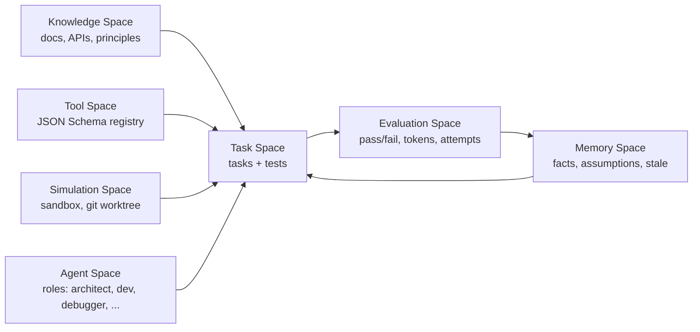

<div align="center">

  

# 🌀 MATRIX

### Artificial work environment for AI capability growth

**Knowledge · Tools · Tasks · Memory · Simulation · Evaluation · Agents**

[](https://www.python.org/)
[](LICENSE)
[](#tests)
[](#architecture)
[](#status)

</div>

---

## What is MATRIX?

MATRIX is an **artificial work environment** where AI agents receive knowledge,
learn tools, solve tasks, verify results, and accumulate experience.

> "Not a chatbot. A training ground."

MATRIX does **not** change model weights. It improves AI through **retrieval,
tools, feedback and measurement**. This is honest: real learning requires
fine-tuning, but structured knowledge + eval loops measurably improve results.

## Core idea

```
Task → Study knowledge → Pick tools → Plan → Execute → Verify → Feedback → Save experience → Reuse
```

## Architecture



### Seven spaces

| Space | Purpose |
|---|---|
| 📚 **Knowledge** | Documentation, APIs, principles with provenance |
| 🔧 **Tools** | Tool registry with JSON Schema, safety rules, examples |
| 📋 **Tasks** | Tasks with conditions, constraints, tests, expected output |
| 🧠 **Memory** | Facts, assumptions, stale knowledge with confidence & TTL |
| 🧪 **Simulation** | Isolated sandboxes, git worktrees, command execution |
| 📊 **Evaluation** | Pass/fail, score, tokens, latency, diff size, feedback |
| 🤖 **Agents** | Specialized roles: architect, developer, debugger, tester, researcher, security, reviewer |

## Quick Start

```bash
pip install -e .
matrix init                          # create matrix.json
matrix stats                         # show stats
matrix tasks                         # list tasks
matrix task reverse-string           # show a task
matrix tools                         # list tools
matrix memory add "Python is 0-indexed" --kind fact --tags python
matrix knowledge search "testing"
matrix agents                        # list agent roles
matrix simulate python -c "print('hi')"
matrix eval                          # evaluation stats
matrix learn                         # learning records
```

## Task format

```json
{
  "id": "reverse-string",
  "title": "Reverse a string",
  "description": "Write a function that reverses a string.",
  "difficulty": "easy",
  "category": "strings",
  "constraints": ["Must handle empty string", "Must handle unicode"],
  "test_cases": [
    {"id": "t1", "description": "basic", "input_data": "hello", "expected": "olleh", "check_type": "equals", "weight": 1.0}
  ],
  "hints": ["Think about slicing"],
  "knowledge_refs": ["testing"],
  "tool_refs": [],
  "max_attempts": 3
}
```

Check types: `equals`, `contains`, `regex`, `not_contains`, `truthy`.

## Memory kinds

| Kind | Meaning |
|---|---|
| `fact` | Verified knowledge |
| `assumption` | Unverified belief |
| `stale` | Expired/outdated knowledge |

Every fact has: source, confidence (0–1), created_at, expires_at, verified flag, tags.

## Agent roles

| Role | Capabilities |
|---|---|
| Architect | design, architecture, planning |
| Developer | implementation, coding, refactoring |
| Debugger | debugging, root-cause-analysis |
| Tester | testing, quality-assurance |
| Researcher | research, documentation, api-study |
| Security | security-review, vulnerability-analysis |
| Reviewer | code-review, quality |

## Evaluation

The evaluator runs test cases against actual output and produces:
- pass/fail per test
- weighted score
- feedback with hints
- token/latency/diff tracking

```python
from matrix import Matrix
m = Matrix()
task = m.tasks.get("fizzbuzz")
result = m.evaluator.evaluate(task, "FizzBuzz", attempt=1)
print(result.passed, result.score, result.feedback)
```

## Learning loop

```python
m = Matrix()
# record an experience
m.learning.record("fizzbuzz", 1, True, strategy="direct", lessons=["use modulo"])
# retrieve lessons for a task
lessons = m.learning.get_lessons("fizzbuzz")
# success rate
rate = m.learning.success_rate()
```

## Simulation

Run commands in isolated sandboxes:
```python
m = Matrix()
result = m.simulation.run_command(["python", "-c", "print('hi')"])
# git worktree for isolated experiments
sandbox = m.simulation.git_worktree("/path/to/repo")
```

## Integration with FORGE ecosystem

| System | Role in MATRIX |
|---|---|
| **FORGE** | Provides tools (scan, verify, sandbox) |
| **SOLAR** | Compresses context, caches results, routes models |
| **ForgeHub** | Provides playbooks and tool registry |
| **Helix** | Observability for the whole loop |

Shared contract:
```
Task { id, repo, goal, constraints, budget }
ContextBundle { files[], diff, knowledge[], memory[] }
ModelPolicy { model, max_tokens, fallback }
Result { diff, tests, tokens, cost, verdict }
```

## Honest limitations

- **No real learning.** Without fine-tuning, MATRIX improves AI via retrieval + tools + feedback, not weight changes. This is honest, not a bug.
- **No GUI.** CLI only.
- **No LLM integration.** MATRIX provides the framework; you plug in the LLM.
- **Simulation is basic.** Git worktree + subprocess, not full container isolation (use Qorvex sandbox for that).
- **Knowledge is static.** No auto-generation from successful tasks yet.
- **Semantic search not included.** Keyword search only; ForgeHub has semantic search.

## Roadmap

- [ ] LLM integration (plug in any model via SOLAR)
- [ ] Auto-generate tasks from real repos
- [ ] Auto-generate playbooks from successful tasks (with human review)
- [ ] Simulation Space with Docker containers
- [ ] Agent Space: multi-agent collaboration
- [ ] GUI dashboard
- [ ] MATRIX + FORGE shared contract
- [ ] MATRIX + SOLAR context compression
- [ ] Semantic search for knowledge

## Tests

```bash
python -m pytest tests -q
# 23 passed
```

## License

MIT

<div align="center">
  
</div>
